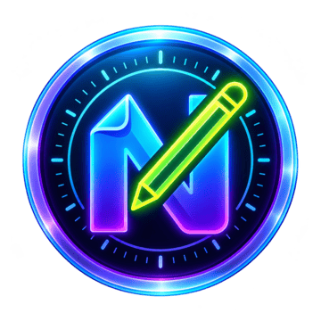
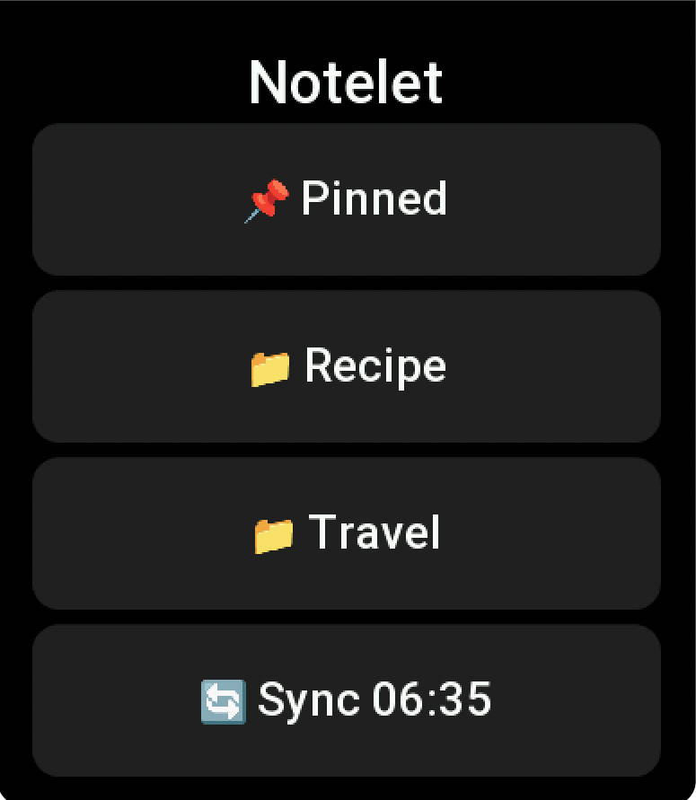
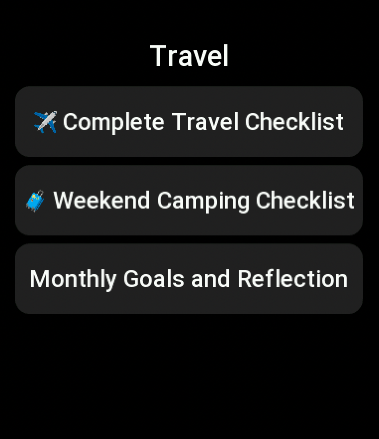
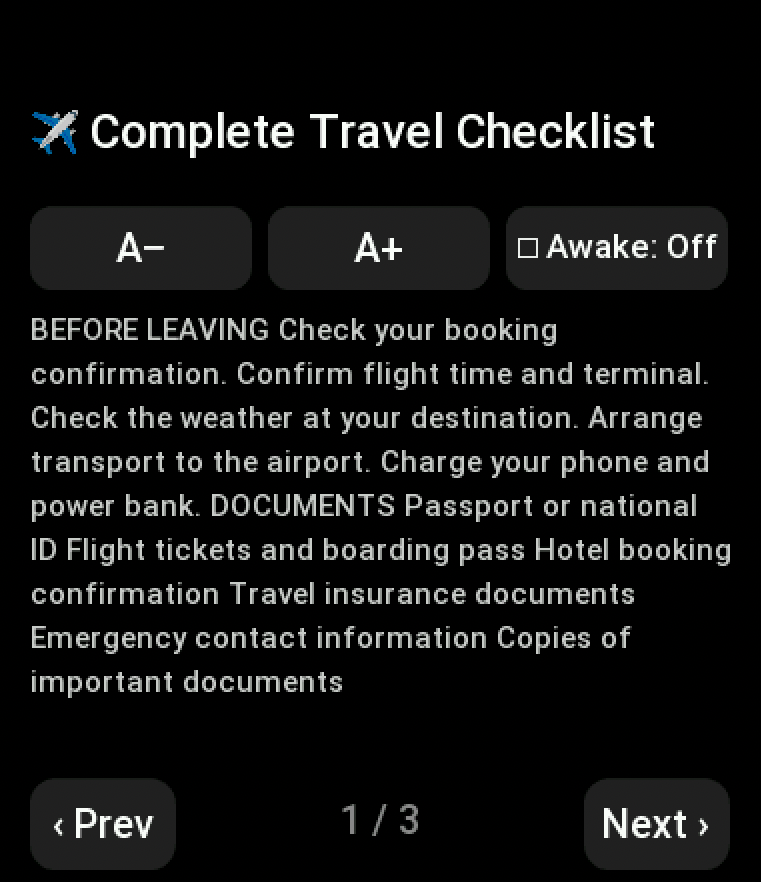
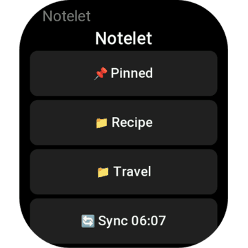
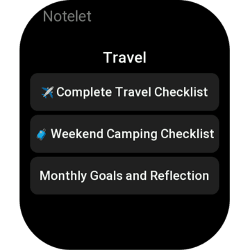
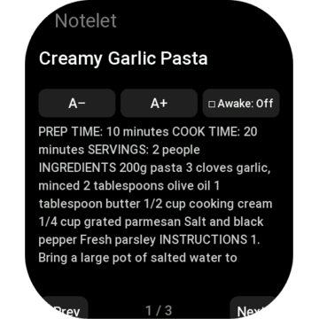
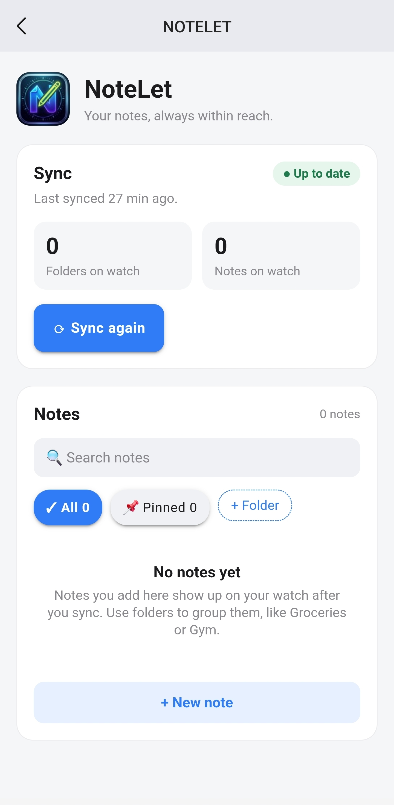

<div align="center">
  
  <h1>Notelet</h1>
  <p><strong>Your notes, always within reach.</strong></p>
  <p>Write notes on your phone. Read them on your Amazfit watch, even offline.</p>
  <p>
    
    
    
    
  </p>
</div>

---

Some things are worth having on your wrist: a shopping list, a gym routine, a packing list, a recipe you're halfway through. Notelet puts them there.

You write and organise notes in the Zepp app on your phone, tap **Sync**, and they're saved on your watch. From then on they're yours to read anywhere, with or without your phone nearby.

## Screenshots

### On your watch

<table>
  <tr>
    <td align="center" width="33%">
      
    </td>
    <td align="center" width="33%">
      
    </td>
    <td align="center" width="33%">
      
    </td>
  </tr>
  <tr>
    <td align="center"><strong>Home</strong><br /><sub>Pinned notes, folders, and sync</sub></td>
    <td align="center"><strong>Folder</strong><br /><sub>Every note in one place</sub></td>
    <td align="center"><strong>Note</strong><br /><sub>Bigger text, keep-awake, page by page</sub></td>
  </tr>
</table>

<details>
<summary>Store previews (360 × 360)</summary>
<br />
<table>
  <tr>
    <td align="center"></td>
    <td align="center"></td>
    <td align="center"></td>
  </tr>
</table>
</details>

### On your phone

<table>
  <tr>
    <td width="300" align="center">
      
    </td>
    <td>
      Notelet's page in the Zepp app is where you write.
      <ul>
        <li><strong>Sync</strong> tells you at a glance whether your watch is up to date.</li>
        <li><strong>Notes</strong> has search, folder tabs, and your pinned notes.</li>
        <li><strong>Edit</strong> opens a note in place: change the text, move it, pin it, or delete it.</li>
      </ul>
    </td>
  </tr>
</table>

## Features

- **Works offline.** Notes are stored on the watch itself, so they're there when your phone isn't.
- **Folders and pins.** Group notes however you like, and pin the ones you need most.
- **Comfortable reading.** Adjust the text size, keep the screen awake while you read, and flip through long notes page by page.
- **Fits your watch.** One app that adapts to round and square screens.
- **Private by design.** No account, no ads, no tracking. Your notes stay between your phone and your watch.

## How it works

1. **Write** notes on Notelet's page in the Zepp app.
2. **Sync** with one tap, from your phone or your watch.
3. **Read** them on your watch, any time, with no connection needed.

Each sync sends a complete copy of your notes to the watch, so what's on your wrist always matches your phone.

## Supported devices

| Device | Screen |
|---|---|
| Amazfit Balance 3 | Round, 480 × 480 |
| Amazfit Balance Ultra | Round, 480 × 480 |
| Amazfit Bip Max | Square, 432 × 514 |

Requires Zepp OS 5.0 (API level 4.4).

## Development

### Prerequisites

- Node.js 18 or later
- The [Zepp OS CLI](https://docs.zepp.com/docs/guides/quick-start/) (`zeus`)
- The Zepp app with a paired watch, or the Zepp OS Simulator

### Run it

```bash
npm install -g @zeppos/zeus-cli
npm install
zeus login
zeus dev        # run in the Simulator
zeus preview    # install on your watch via a QR code in the Zepp app
```

### Build for release

```bash
zeus build      # creates dist/<appId>-Notelet-<version>-<timestamp>.zab
```

Store listing copy, the privacy statement and the submission checklist are in [docs/store/listing.md](docs/store/listing.md).

### Project structure

```text
Notelet/
├── page/         Watch screens: home, folder, note
├── setting/      Phone screen in the Zepp app: notes, folders, sync
├── app-side/     Bridge between phone and watch
├── utils/        Storage, sync and layout helpers for the watch
├── assets/       App icons for round and square watches
└── docs/         Architecture notes and store listing
```

For the full design, including the sync model and platform constraints, see [docs/architecture.md](docs/architecture.md).
